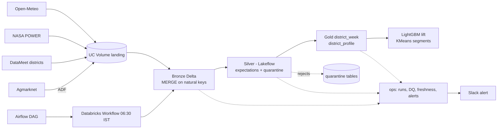
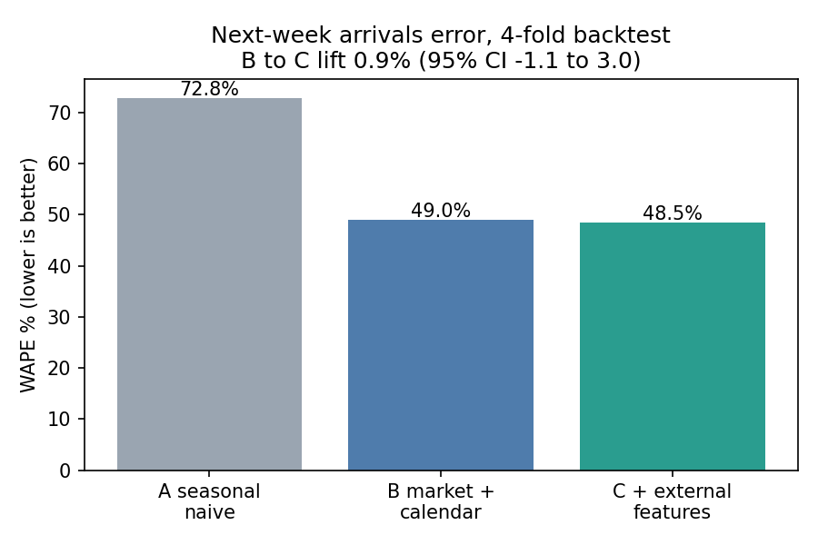
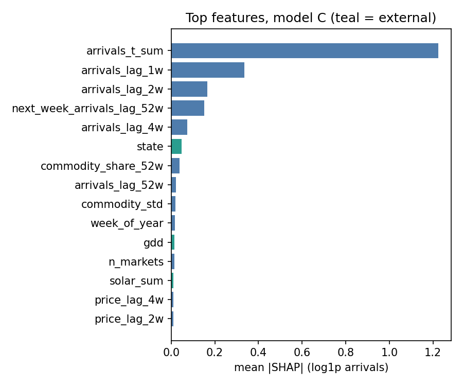
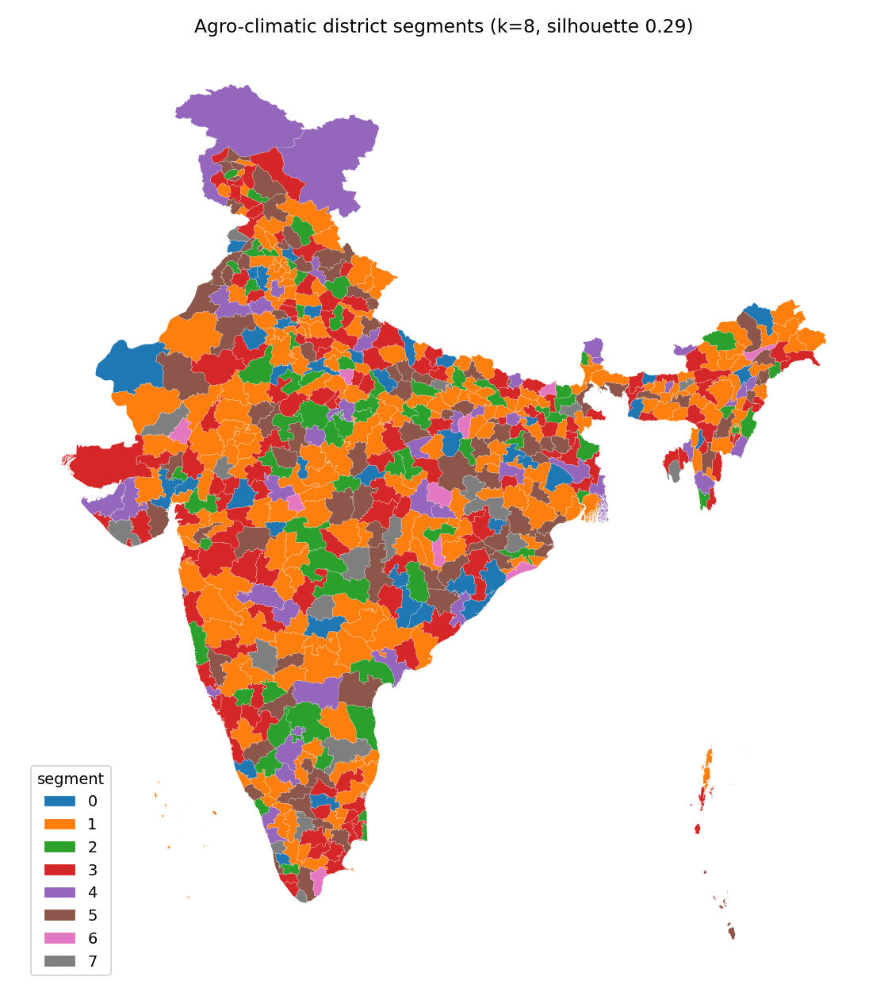

# AgriPulse: external-data lakehouse for agri demand forecasting

[](https://github.com/kdt523/agripulse/actions/workflows/ci.yml)


PySpark pipelines ingest four external sources (weather API, NASA POWER agro-climate, mandi market prices, district geo data) into a Databricks medallion lakehouse with enforced data quality, freshness SLAs and a Unity Catalog data catalogue. A downstream experiment then measures what the external features are actually worth for a LightGBM demand forecast, and powers an agro-climatic district segmentation.

## Results (measured; source: [docs/results.md](docs/results.md))

__RESULTS_TABLE__

## Architecture


Full diagram and layer notes: [docs/architecture.md](docs/architecture.md).

## Data sources
| Source | What | Licence | Notes |
|---|---|---|---|
| [Open-Meteo](https://open-meteo.com) | Daily weather + 16-day forecast per district centroid | CC BY 4.0 | Free-tier quota shapes the backfill |
| [NASA POWER](https://power.larc.nasa.gov) | Agro-climate: solar radiation, soil wetness, temperature, rain | Public domain | Carries the multi-year history |
| [Agmarknet](https://agmarknet.gov.in) | Mandi prices and arrivals | Govt. of India open data | History from the public archive (2013-2017); live via Azure Data Factory |
| [DataMeet](https://github.com/datameet/maps) | 641 Census-2011 districts | CC BY 4.0 | Centroids drive all API calls |

Why each was chosen, what was observed and what was rejected: [docs/sources.md](docs/sources.md).

## Medallion layers and data quality
- **Bronze**: raw but typed-enough, with `_ingested_at/_source/_run_id/_request_params`. Raw files land in a Volume first (replayable). Every write is a Delta `MERGE` on natural keys, and re-running a window inserts zero rows.
- **Silver** (Lakeflow Declarative Pipeline): standardised units and names, `__EXPECT_COUNT__` expectations (drop / warn / fail), a `*_quarantine` table per silver table with the failed rule names, and a schema contract that fails the update on bronze drift.
- **Gold**: `district_week` (district x ISO week x commodity, leakage-safe, documented in the [feature dictionary](docs/feature_dictionary.md)), `district_profile`, `v_ds_training`.
- **Ops**: `pipeline_runs`, `ingest_watermarks`, `dq_scorecard`, `freshness_status`, `alert_log`.
- Catalogue: every table and column has a comment and tags ([DATA_CATALOG.md](docs/DATA_CATALOG.md), generated from Unity Catalog).

## Orchestration and monitoring
Databricks Workflow `agripulse_daily` (06:30 IST): ingest in parallel -> name map -> silver -> gold -> DQ scorecard -> freshness check, with retries, timeouts and failure email. An Airflow DAG triggers the same job and re-checks freshness independently. An Azure Data Factory pipeline definition copies Agmarknet from data.gov.in to ADLS, because that API is unreachable from Databricks Free Edition. Alerts (freshness, DQ pass rate, volume anomaly) are written to `ops.alert_log` and pushed to Slack when a webhook is configured.

__ORCH_SECTION__

## Proof of value
__PROOF_SECTION__





## Quickstart
```bash
git clone https://github.com/kdt523/agripulse && cd agripulse
pip install -e ".[dev]"              # needs JDK 17 for the Spark tests
pytest                               # unit tests
databricks configure --profile agripulse
databricks secrets create-scope agripulse   # then put slack_webhook (and datagov_api_key if you have one)
databricks bundle validate -t dev && databricks bundle deploy -t dev
databricks bundle run agripulse_setup -t dev
databricks bundle run agripulse_ingest -t dev --params source=geo
databricks bundle run agripulse_ingest -t dev --params source=nasa_power,mode=backfill,start=2021-01-01
```
Everything else (mandi archive, name map, silver, gold, ML) is in the [runbook](docs/runbook.md).

## Design decisions and trade-offs
- **Free Edition limits drove the design.** `api.data.gov.in` is not reachable from serverless compute (verified with a probe job), so mandi history comes from the public Agmarknet archive and the live path goes through Azure Data Factory. Open-Meteo's free quota (~10k weighted calls/day) is why its backfill is quota-aware and resumable, and why NASA POWER carries the multi-year history.
- **Lakeflow (DLT) for silver** because expectations, event-log metrics and quarantine routing are first-class there. Rules live in one module ([expectations.py](src/agripulse/quality/expectations.py)) and are shared by the pipeline, the tests and the docs.
- **Workflows primary, Airflow on top.** Workflows has native task dependencies, retries and pipeline tasks. The Airflow DAG shows cross-tool orchestration without duplicating logic.
- **District-name matching is the hard part.** 14.1% of mandi rows had no district until 24 manual overrides brought it to 2.85% (exact -> fuzzy within state -> override, all recorded in `ops.district_name_map`).
- **Quality rules were tested against reality, then against injected faults.** Two rules changed because of it: the temperature floor rejected real Himalayan winters, and a chaos test found a missing-key gap and a warn-only spike rule.
- **Honest results.** The forecast-lift effect is small and its confidence interval includes zero. It is reported that way.

## Roadmap
- Load the ICRISAT crop-area export and replace the mandi-derived crop mix.
- Extend Open-Meteo history as daily quota allows; replace NASA temperature extremes with ERA5 where available.
- Mandi data after 2017 via the live API (needs the Azure Data Factory pipeline deployed).
- Hierarchical or per-segment forecasts using the segmentation.
