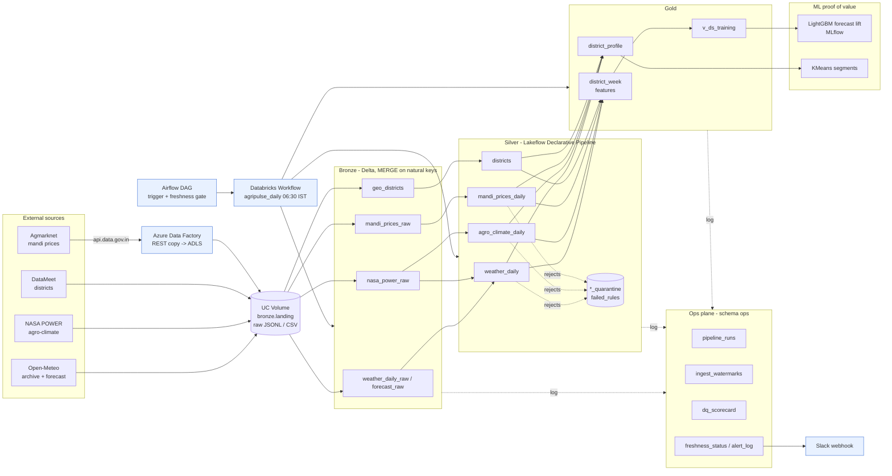

# Architecture

## Layers
- **Bronze**: raw but typed-enough. Carries `_ingested_at`, `_source`, `_run_id`, `_request_params`. Raw files are first landed in the Volume, so any load is replayable. Every write is a Delta `MERGE` on natural keys, so re-running a window never duplicates rows.
- **Silver**: Lakeflow Declarative Pipeline. Standardises units and names, applies expectations, and routes every rejected row to a `_quarantine` table with the failed rule names. A schema-contract check fails the whole update if a bronze table lost a required column.
- **Gold**: `district_week` (district x ISO week x commodity) for data science, `district_profile` for segmentation, and `v_ds_training` with next-week targets. Leakage rules are in `feature_dictionary.md`.
- **Ops**: run log, watermarks, DQ scorecard, freshness status, alert log. Everything is queryable with SQL.

## Orchestration
Databricks Workflows is the primary scheduler. The daily DAG runs: geo gate (Mondays) -> weather / NASA / forecast / mandi ingest in parallel -> name map -> silver pipeline -> gold build -> DQ scorecard -> freshness check. Airflow triggers the same job and independently re-checks freshness, to show cross-tool orchestration.
